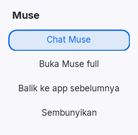
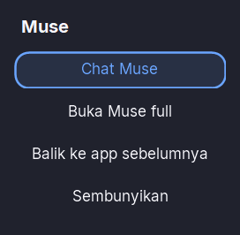

# MuseBubbleWin

A small, unofficial Windows desktop companion for [muse.ai](https://muse.ai/).
Keep Muse in a floating chat window, open it from a draggable bubble, and switch
between an Apple-inspired light or dark frame.

**Independent community project. Not affiliated with or endorsed by Meta or Muse.**

## Features

- Floating bubble with Muse's official app icon, downloaded and cached on first run.
- Compact WebView2 chat with a persistent sign-in profile.
- Light/dark theme, draggable title bar, and a keep-on-top toggle.
- Quick actions, tray menu, optional Windows startup, bubble size and opacity controls.
- Host-owned Windows attachment picker for cases where WebView2's picker fails to appear.
- Optional, reversible styling of the embedded Muse page.

### Native quick-panel previews

These previews show the app's native controls, not a fabricated chat conversation.

| Light | Dark |
| --- | --- |
|  |  |


### Quick guide

- **One click** on the bubble opens or closes the chat; **double-click** opens Muse in your browser.
- **Drag** the bubble anywhere — its position is remembered. **Hover** over it for the quick-action panel.
- **Scroll** on the bubble to resize it; **Ctrl+scroll** changes its opacity.
- In the chat window: the **pin** icon keeps it on top, the **sun/moon** switches light/dark, and the **+** in the message box attaches a file.

Full details in [Controls](#controls).

## Requirements

- Windows 10/11, x64, with .NET Framework 4.8 or later.
- [Microsoft Edge WebView2 Runtime](https://developer.microsoft.com/en-us/microsoft-edge/webview2/).
- Internet access and your own Muse account to use the embedded service.
- For the default source build: [.NET 10 SDK](https://dotnet.microsoft.com/download/dotnet/10.0).

The app does not require an OpenAI API key. Any Muse account or service charges are
separate from this wrapper.

## Build and run

Fork or download this repository, then in PowerShell on Windows:

```powershell
./build.ps1
./artifacts/Release/MuseBubbleWin.exe --show-chat
```

The build restores the pinned WebView2 SDK from NuGet. Keep the whole output folder
together, including the managed WebView2 DLLs and native loader. The browser runtime
is installed separately; copying the EXE alone is insufficient.

You can also open `MuseBubbleWin.csproj` in a compatible Visual Studio installation,
or run `dotnet build MuseBubbleWin.csproj -c Release`.

For an offline C# compiler build, supply a folder containing
`Microsoft.Web.WebView2.Core.dll`, `Microsoft.Web.WebView2.WinForms.dll`, and the **x64**
`WebView2Loader.dll` from the matching WebView2 SDK:

```powershell
./build.ps1 -WebView2SdkPath C:/path/to/webview2-sdk-dlls
```

The **Actions** tab produces a portable Windows build artifact when its workflow passes.
No prebuilt executable or browser profile is committed to the source repository.

## Controls

- Click the bubble to toggle chat; double-click to open Muse in your browser.
- Drag the bubble to reposition it; hover for the quick-action panel.
- Scroll over the bubble to resize; Ctrl+scroll changes its opacity.
- Right-click the bubble/tray icon for theme, size, opacity, startup, and exit options.
- The chat's red dot hides chat; yellow returns to the previous app; green opens Muse in the browser.
- Click the sun/moon to switch themes and the pin to toggle keeping chat on top.
- Drag the chat title bar to move it.
- Right-click that title bar to toggle **Style Muse page**, enable attachment tracing, or open DevTools.
- Click **+** in the message box to attach a file; the app's own Windows file picker opens.
- Double-click the tray icon (or choose **Tampilkan**) to bring back a hidden bubble.
- Bubble position, size, opacity, and theme are remembered between runs.
- Choose **Keluar** in the tray menu to quit. Closing/hiding chat leaves the bubble running.

Some action labels are currently in Indonesian; localization contributions are welcome.

## Local data

- Settings: `%APPDATA%/MuseBubbleWin/settings.ini`
- Browser profile and sign-in state: `%APPDATA%/MuseBubbleWin/WebView2Data/`
- Cached official icon: `muse-official-icon.png` beside the executable.
- Diagnostic log: `attachment-trace.log` beside the executable.

Use a user-writable installation folder. If the official icon cannot be downloaded,
a neutral **M** placeholder is shown until a subsequent successful launch. A cached
icon works offline. Credentials and profiles are never included in this repository.
WebView2's normal permission handling is retained in this public version.

## Checks

After building, run:

```powershell
./tests/run.ps1
node tests/theme-checks.cjs
```

The native checks cover title-bar layout at several scales, accessible labels, theme
and pin state, and a pixel-level regression for clipped/opaque button repainting.
The Node check covers the page-style origin guard, theme toggle, disable behavior,
input-handler preservation, and palette contrast. Node is only needed for that check.

These checks do **not** verify a signed-in Muse session, a complete upload, real desktop
repaint behavior on every GPU/DPI setup, or the current third-party chat layout.

## Known limitations

- The Muse website owns chat content and layout. Site updates may require changes to
  the optional style layer; disable **Style Muse page** if it interferes.
- Attachments use a classic Windows file picker, which looks different from modern Explorer.
  Chooser interception relies on experimental Chrome DevTools Protocol APIs.
- The app is x64; ARM64 and x86 builds are not tested.
- Borderless-window effects depend on the Windows version and display configuration.
- The SDK-style NuGet build and GitHub workflow need their own successful CI run;
  the original local verification used the .NET Framework compiler and existing SDK DLLs.

## Forking and contributing

Code is available under the [MIT license](LICENSE). Fork it, build it, and send a pull
request; see [CONTRIBUTING.md](CONTRIBUTING.md). Third-party components, the Muse service,
and branding retain their own terms; see [THIRD_PARTY_NOTICES.md](THIRD_PARTY_NOTICES.md).
